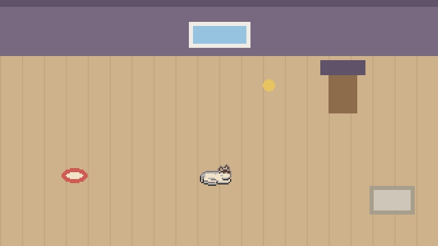

# pocket-pet 🐈

一只**离线**的桌面暹罗猫：它有自己的驱动力（饿、困、无聊、粘人、猫砂、好奇、胆大、懒、毛乱），
每几秒钟问自己一次"接下来干嘛"，然后从 **8 个目标**里挑一个去做。
那个"小脑"是一个 **14.2M 参数**的 transformer，全部在本地跑，**不联网、不连云**。

这是 [pocket-tank](https://github.com/mediacutlet/pocket-tank) 的衍生项目：同一套
"**反射层（每帧）+ 顾问层（挑目标）**"架构，换了物种、状态、目标和世界，
推理引擎与 SIMD 内核可以原样复用。



## 它现在到哪一步了

| 里程碑 | 状态 | 证据 |
|---|---|---|
| M1 schema + 8 个目标 + 情境采样器 | ✅ | `check_schema` → `SCHEMA_OK fields=17 goals=8`；采样同 seed 逐字节幂等 |
| M2 rubric + 种子集(361) + 留出评测集(563) | ✅ | `SEED_OK n=361 goals=8 min_goal=45 top_goal=13%`；`NO_LEAK train/val/eval` |
| M3 deepseek-flash 标注 **49,950 条** | ✅ | **实测花费 ¥8.35**（预算 ¥40）、缓存命中 306 万 token、坏行 0.1% |
| M4 训练 14M 学生 + 与手标一致率 | 🔄 训练中 | `runs/v1/curve.json` |
| M5 Q4 导出 + 上板 | ⛔ v2 | 需要对上 pocket-tank 的 `model/` 导出格式 |
| M6 房间世界 + 无头模拟 + GIF | ✅ | 10 分钟模拟覆盖 8/8 目标；见下面的分布 |

## 猫的一天长什么样（模拟 10 分钟，seed 7）

```
sleep 1471   play 1319   follow_owner 1015   explore 780
scratch 544  seek_food 493   hide 236   groom 142      （6000 步）
```

不是"饿→吃→睡"的死循环：它会跟着人走、会突然躲起来（人起身时胆小的猫会躲）、
会在夜深时睡、会在无聊时自己找乐子。**10% 的"没道理"是有意留的**——
没有它，猫会变成一台按优先级排队的机器。

## 它怎么决定做什么

```
hunger 6 energy 3 bored 5 clingy 7 litter 2 scruff 1 curiosity 8 bold 4 lazy 5 stage adult
food near 3 toy mid 9 owner far 6 litter_box near 12 window none last play time night
```

这一行就是模型的**全部输入**；输出是 8 个目标之一（外加一个 0–3 的紧急度）：
`seek_food sleep play groom follow_owner scratch explore hide`。

- **判断标准**（我的）写成显式 rubric：`docs/pet/labeling_rubric.md` + `pocket_pet/rubric.py`
  ——13 条优先级、各边界判法、10% 性格噪声。改 rubric 等于改猫的性格，必须走 ECN。
- **老师**：`deepseek-flash`，拿着 rubric + 8 条范例，一次标 25 条情境，
  自动记账（`data/label_cost.json`）。**关掉思考模式**是省钱的关键。
- **学生**：14.2M 的 llama2.c 风格模型（dim 384 / 8 层 / 8 头 / 词表 60 / seq 64），
  学的是"状态行的下一个 token = 目标"。
- **评测**：留出集（563 条，与训练集按状态行 hash 互斥）上的**一致率**，
  外加**多数类基线**做反作弊——防止模型"全押 seek_food"刷分。

## 跑起来

```bash
uv sync
uv run python -m pocket_pet.sim --minutes 5 --report          # 带顾问
uv run python -m pocket_pet.sim --minutes 5 --no-advisor      # 只有反射层（也能活）
uv run python tools/make_gif.py --minutes 5 --fps 8           # 重新渲染 GIF
uv run pytest tests/unit -q

# 数据管线
uv run python -m pocket_pet.sample --n 50000 --seed 7 --out data/situations.jsonl
uv run python tools/make_seed.py                              # rubric 导出种子 + 评测集
DEEPSEEK_API_KEY=... uv run python -m pocket_pet.label --all  # 调 API 标注（记账在 data/label_cost.json）
uv run python -m pocket_pet.train --config configs/v1.yaml --max-rows 8000 --epochs 3
uv run python -m pocket_pet.eval                              # 一致率 + 混淆矩阵 + 分歧导出
```

## 项目纪律（塔山开发循环）

- PRD：`docs/prd/PRD-0001-pocket-pet-cat.md`（10 条需求，每条**二元可判** + **反作弊条款**）
- 计划：`docs/plan/v1-index.md`（6 个里程碑 + **追溯矩阵** + 触发审计）
- 变更：`docs/ecn/`（ECN-0001 反射层 vs 顾问层的覆盖要求；ECN-0002 用 rubric 导出数据集）
- 抽检：`docs/pet/rubric_spotcheck.md`（15 条人工复核：14 认可，抓到 1 处自相矛盾并修）

## 板上的猫（M5Stack Tab5 / ESP32-P4）

它已经在真机上跑起来了：房间铺满 1280×720 横屏，暹罗猫在里面自己喝水、走去吃饭、睡觉，
每 4 秒问一次**板上**的 14.2M 模型该干嘛。全部证据（日志原文）在
[`docs/plan/v1.1-evidence.md`](docs/plan/v1.1-evidence.md)。

| 项 | 实测 |
|---|---|
| 面板 | ST7123 720×1280，横屏 1280×720，**18–20 fps** |
| 屏幕旋转 | `swap_xy` 会花屏 ✗；PPA 只覆盖 2/3 ✗；最终 **CPU 转 + 只转脏矩形** ✓ |
| 大脑 | `brain ready: dim 384 … vocab 53`；`hunger 8 … → seek_food` **p=0.90**；PIE 自检一致 ✓ |
| 速度 | 板上 `bench 4` → **447.93 tok/s**（门禁 ≥8）；单次决策 ~1.4–1.9 s |
| 引擎 | `vendor/llm/` 从 pocket-tank **原样拷入，零改动** ✓ |
| 记忆 | 驱动值/位置/目标存 nvs，开机 `cat remembered: hunger 9 energy 0 goal explore` ✓ |
| 时钟 | RTC（RX8130CE @0x32）→ `time` 真的会变成 dawn/day/dusk/night ✓ |
| 交互 | 控制台 `food/water/play/pet/clean/status/cat/bench/dotcheck/info` + **触摸点按** |

### 刷到板子上

```powershell
$env:IDF_TOOLS_PATH='E:\Espressif'; . 'E:\Espressif\frameworks\esp-idf-v5.5.6\export.ps1'
cd firmware; idf.py build
python -m esptool --chip esp32p4 -p COM9 -b 460800 write_flash --flash_mode dio --flash_size 16MB --flash_freq 80m `
  0x10000 build\pocket_pet_brain.bin 0x290000 E:\development\pocket-pet\build\cat_q4.bin
```

模型固定烧在 **0x290000**（与 pocket-tank 的分区表同址），两个模型可以一条 esptool 命令互换；
鱼缸模型的字节级备份在 `backup/fish_model_0x290000.bin`。

### 跟它互动

```powershell
# 控制台（鱼缸 director 那套）
cd E:\development\pocket-tank
python tools\tab5_console.py COM9 "food" 8 --wait-for "cat>"

# 或者直接点屏幕：食盆=喂 / 水碗=加水 / 玩具=陪玩 / 猫砂盆=清洁 / 猫爬架=抓挠 / 猫身上=撸
```

## 素材与许可

- 猫的精灵图派生自 OpenGameArt 的 **"[LPC] Cats and Dogs"**（作者 bluecarrot16，**CC-BY 3.0**），
  本项目把白猫配色改成**暹罗配色**（奶油身 + 深褐重点）。署名与要求见 `assets/CREDITS.md`。
- 本仓库其余代码：与上游 pocket-tank 一致（MIT）。
